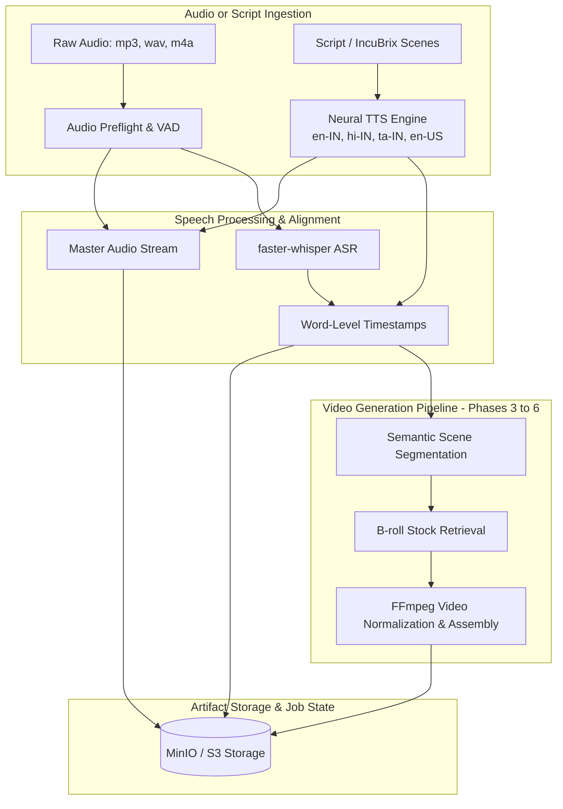

# IncuBrix Script, Voiceover & B-roll Video Engine (PS3)

> **IncuBrix 2027 Software Engineer Assessment — Problem Statement 3 (PS3)**  
> **Status:** Phase 2 Complete (Speech Processing & Narration Engine)  
> **API Version:** 0.1.0 (OpenAPI 3.1)  

---

## 1. System Overview

The **Script, Voiceover & B-roll Video Engine** is a containerized microservice that turns a voiceover audio recording or plain text script into a finished, commercially cleared, broadcast-ready B-roll video.

- **Phase 1 (Completed):** Enterprise foundation, FastAPI with OpenAPI 3.1, background jobs (HTTP 202), `Idempotency-Key` handling, SQLite persistence with WAL mode, MinIO S3 storage, structured JSON logging, and health probes.
- **Phase 2 (Completed):** Speech Processing & Narration Engine:
  - Audio preflight validation for MP3, WAV, M4A with 10-minute duration enforcement.
  - Energy-based Voice Activity Detection (VAD) and silence rejection (`NO_SPEECH_DETECTED`).
  - Modular Speech-to-Text (ASR) via `faster-whisper` with frame-accurate word-level timestamps.
  - Multilingual support for English, Hindi (`hi-IN`), and Tamil (`ta-IN`).
  - Modular Text-to-Speech (TTS) via `edge-tts` supporting Indian English, US English, Hindi, and Tamil voices with word boundary timings.

---

## 2. Architecture & Pipeline



---

## 3. Testing & Verification Modes

### Mode A: Automated Offline Test Suite (41 Tests, 100% Offline, Zero API Keys)

Runs unit, integration, and failure-recovery tests deterministically using mock speech providers and in-memory persistence:

```bash
# Run all 41 automated tests on host
pytest -v

# OR run all 41 automated tests inside isolated Docker container
docker compose run --rm test
```

### Mode B: Live Real-Model Speech Verification (faster-whisper + edge-tts)

Benchmarks real neural TTS synthesis and CTranslate2 Whisper ASR across English, Hindi, and Tamil:

```bash
# Runs real edge-tts voices, Silero VAD, and faster-whisper INT8 transcription
python scripts/verify_real_speech.py
```

---

## 4. Supported Neural Voices (Multilingual)

| Language | Accent / Locale | Voice Identifier | Voice Character |
| :--- | :--- | :--- | :--- |
| **English** | Indian (`en-IN`) | `en-IN-female` (`en-IN-NeerjaNeural`) | Professional, modern Indian female |
| **English** | Indian (`en-IN`) | `en-IN-male` (`en-IN-PrabhatNeural`) | Warm, clear Indian male |
| **English** | United States (`en-US`) | `en-US-female` (`en-US-JennyNeural`) | Conversational US female |
| **English** | United States (`en-US`) | `en-US-male` (`en-US-GuyNeural`) | Confident US male |
| **Hindi** | India (`hi-IN`) | `hi-IN-female` (`hi-IN-SwaraNeural`) | Natural Hindi female narration |
| **Hindi** | India (`hi-IN`) | `hi-IN-male` (`hi-IN-MadhurNeural`) | Resonant Hindi male narration |
| **Tamil** | India (`ta-IN`) | `ta-IN-female` (`ta-IN-PallaviNeural`) | Authentic Tamil female narration |
| **Tamil** | India (`ta-IN`) | `ta-IN-male` (`ta-IN-ValluvarNeural`) | Expressive Tamil male narration |

---

## 5. Standard Error Codes Reference

All error responses strictly follow the RFC-compliant schema defined in Integration Standard Point 5:

```json
{
  "error": {
    "code": "UPPER_SNAKE_CASE",
    "message": "Human-readable description",
    "retryable": false,
    "details": {}
  }
}
```

| Error Code | HTTP Status | Retryable? | Description |
| :--- | :--- | :--- | :--- |
| `VALIDATION_ERROR` | `422` | No | Request payload failed schema validation. |
| `JOB_NOT_FOUND` | `404` | No | Requested `job_id` does not exist. |
| `AUDIO_FILE_NOT_FOUND` | `400` | No | Specified audio file path does not exist. |
| `UNSUPPORTED_AUDIO_FORMAT` | `400` | No | Input format is not `.mp3`, `.wav`, or `.m4a`. |
| `CORRUPTED_AUDIO_FILE` | `400` | No | Audio header or data could not be decoded. |
| `AUDIO_EXCEEDS_MAX_DURATION` | `400` | No | Audio duration exceeds 10 minutes (600s). |
| `AUDIO_TOO_SHORT` | `400` | No | Audio duration is shorter than 0.5s. |
| `NO_SPEECH_DETECTED` | `400` | No | Audio is silent or contains background music only. |
| `RATE_LIMITED` | `429` | Yes | Rate limit reached. |
| `SERVICE_UNAVAILABLE` | `503` | Yes | Database or storage readiness check failed. |
| `INTERNAL_SERVER_ERROR` | `500` | Yes | Unexpected internal error. |

---

## 6. Configuration Reference (`.env.example`)

| Variable | Default Value | Description |
| :--- | :--- | :--- |
| `ASR_PROVIDER` | `mock` / `faster-whisper` | Speech-to-text provider (`mock` for fast CI). |
| `TTS_PROVIDER` | `mock` / `edge-tts` | Text-to-speech provider (`mock` for fast CI). |
| `WHISPER_MODEL_SIZE` | `small` | Model size: `tiny`, `base`, `small`, `medium`. |
| `MAX_AUDIO_DURATION_SECONDS` | `600.0` | Maximum audio duration in seconds (10 min). |
| `DATABASE_URL` | `sqlite+aiosqlite:///data/jobs.db` | Job persistence database URL. |
| `S3_ENDPOINT_URL` | `http://localhost:9000` | MinIO / S3 endpoint URL. |
| `WEBHOOK_SECRET` | `default-test-...` | HMAC secret for `X-IncuBrix-Signature`. |
