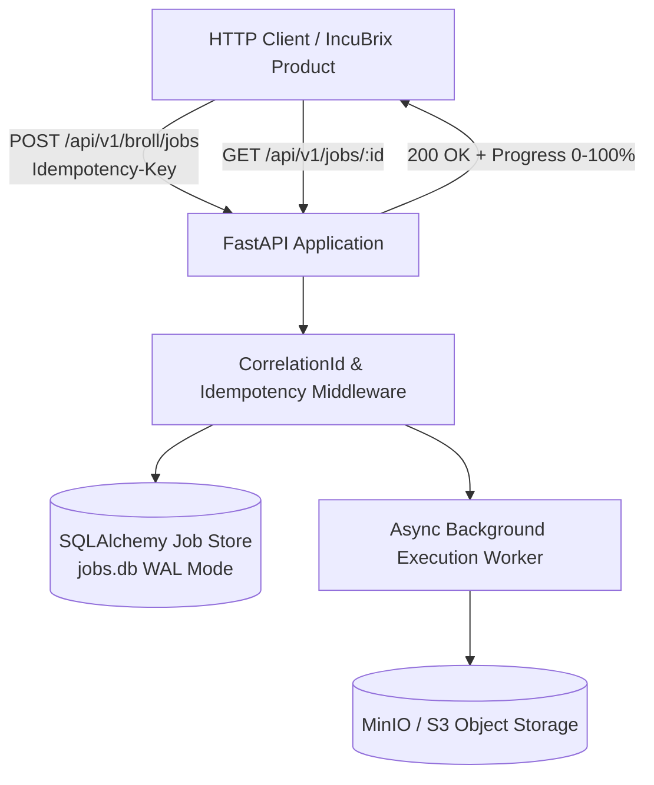

# IncuBrix Script, Voiceover & B-roll Video Engine (PS3)

> **IncuBrix 2027 Software Engineer Assessment — Problem Statement 3 (PS3)**  
> **Status:** Phase 1 Complete (Foundation & Integration Standards)  
> **API Version:** 0.1.0 (OpenAPI 3.1)  

---

## 1. System Overview

The **Script, Voiceover & B-roll Video Engine** is a containerized microservice that turns a voiceover audio recording or plain text script into a finished, commercially cleared, broadcast-ready B-roll video.

Phase 1 establishes the production-grade architectural foundation and completes the **IncuBrix Integration Standard** requirements:
- **FastAPI Core:** Clean REST API with all routes under `/api/v1/` and full **OpenAPI 3.1** specification (`openapi.yaml`).
- **Asynchronous Background Jobs:** Asynchronous job execution with progress tracking (0–100%) and HMAC-SHA256 callback webhooks.
- **Safe Retries (Idempotency):** Strict `Idempotency-Key` header support preventing duplicate computation.
- **Persistent Job Store:** SQLite database with WAL mode and asynchronous SQLAlchemy (`aiosqlite`), resilient across process restarts.
- **S3-Compatible Storage:** MinIO / AWS S3 storage adapter via `boto3` for media assets and outputs.
- **Structured JSON Logging:** Emits single-line JSON logs with UTC timestamps, log levels, `job_id`, and `X-Correlation-Id`.
- **Health Checks:** `/health` (liveness) and `/ready` (dependency readiness).
- **100% Offline Test Suite:** Automated tests run completely offline without external paid API keys.

---

## 2. Architecture & Data Flow



---

## 3. Quickstart Guide (Under 10 Commands)

### Option A: Running with Docker Compose (Recommended)

Start the engine, MinIO storage, and automatic bucket initialization:

```bash
# 1. Start all services
docker compose up -d

# 2. Check service health
curl http://localhost:8000/health
curl http://localhost:8000/ready

# 3. Submit a video job
curl -X POST http://localhost:8000/api/v1/broll/jobs \
  -H "Content-Type: application/json" \
  -H "Idempotency-Key: demo-key-001" \
  -d '{"script": "IncuBrix automated video engine demo.", "aspect_ratios": ["16:9"]}'

# 4. View logs
docker compose logs -f engine

# 5. Run automated test suite inside Docker
docker compose run test
```

### Option B: Local Python Development Setup

```bash
# 1. Create and activate virtual environment
python -m venv .venv
source .venv/bin/activate  # On Windows: .venv\Scripts\activate

# 2. Install dependencies
pip install -e ".[dev]"

# 3. Copy configuration
cp .env.example .env

# 4. Run automated test suite (100% offline)
pytest -v

# 5. Start development server
python -m broll_engine.main
```

---

## 4. API Endpoints Reference

| Method | Endpoint | Description | Status Code |
| :--- | :--- | :--- | :--- |
| `GET` | `/health` | Liveness probe confirming process is responsive. | `200 OK` |
| `GET` | `/ready` | Readiness probe verifying database and storage connectivity. | `200 OK` / `503 Service Unavailable` |
| `POST` | `/api/v1/broll/jobs` | Submit a new video creation job (accepts `Idempotency-Key`). | `202 Accepted` |
| `GET` | `/api/v1/jobs/{job_id}` | Check job status, progress (0–100%), stage, and artifact links. | `200 OK` / `404 Not Found` |
| `GET` | `/api/v1/jobs` | List recent jobs ordered by creation date descending. | `200 OK` |

Interactive Swagger documentation is available at `http://localhost:8000/docs` and ReDoc at `http://localhost:8000/redoc`.

---

## 5. Standard Error Codes Reference

All error responses strictly follow the RFC-compliant schema defined in Integration Standard Point 5:

```json
{
  "error": {
    "code": "UPPER_SNAKE_CASE",
    "message": "Human-readable description",
    "retryable": false,
    "details": {}
  }
}
```

| Error Code | HTTP Status | Retryable? | Description |
| :--- | :--- | :--- | :--- |
| `VALIDATION_ERROR` | `422` | No | Request payload failed Pydantic schema validation. |
| `JOB_NOT_FOUND` | `404` | No | Requested `job_id` does not exist in the database. |
| `BAD_REQUEST` | `400` | No | Malformed request syntax or parameters. |
| `RATE_LIMITED` | `429` | Yes | Client or downstream provider rate limit exceeded. |
| `SERVICE_UNAVAILABLE` | `503` | Yes | Database or storage dependency is offline (`/ready` probe failed). |
| `INTERNAL_SERVER_ERROR` | `500` | Yes | Unexpected internal failure. |

---

## 6. Configuration Reference (`.env.example`)

| Variable | Default Value | Description |
| :--- | :--- | :--- |
| `APP_ENV` | `development` | Environment mode (`development`, `test`, `production`). |
| `APP_PORT` | `8000` | Port for the HTTP API server. |
| `DATABASE_URL` | `sqlite+aiosqlite:///data/jobs.db` | Async SQLAlchemy connection URL. |
| `S3_ENDPOINT_URL` | `http://localhost:9000` | MinIO or S3 endpoint URL. |
| `S3_ACCESS_KEY_ID` | `minioadmin` | S3 access key. |
| `S3_SECRET_ACCESS_KEY` | `minioadmin` | S3 secret key. |
| `S3_BUCKET_NAME` | `broll-engine-bucket` | Storage bucket for uploaded media and outputs. |
| `WEBHOOK_SECRET` | `default-test-...` | Secret key used for HMAC-SHA256 signature headers. |

---

## 7. Compliance & Rights

- **Commercial Use:** All runtime dependencies are permissively licensed (MIT, Apache 2.0, BSD).
- **AGPL Decoupling:** MinIO runs as an isolated network container; application code strictly uses the Apache-2.0 `boto3` client.
- **Zero Secrets:** No credentials or API keys are committed to Git.
