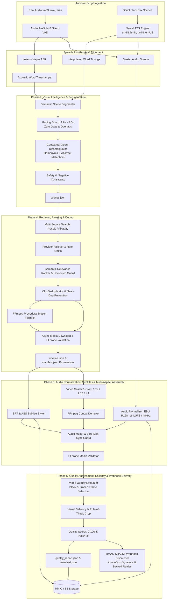

# IncuBrix Script, Voiceover & B-roll Video Engine (PS3)

> **IncuBrix 2027 Software Engineer Assessment — Problem Statement 3 (PS3)**  
> **Status:** Phase 7 Complete (Clip Swapping, Partial Re-rendering & CLI Batch Runner)  
> **API Version:** 0.1.0 (OpenAPI 3.1)  

---

## 1. System Overview

The **Script, Voiceover & B-roll Video Engine** is a containerized microservice that turns a voiceover audio recording or plain text script into a finished, commercially cleared, broadcast-ready B-roll video.

- **Phase 1 (Completed):** Enterprise foundation, FastAPI with OpenAPI 3.1, background jobs (HTTP 202), `Idempotency-Key` handling, SQLite persistence with WAL mode, MinIO S3 storage, structured JSON logging, and health probes.
- **Phase 2 (Completed):** Speech Processing & Narration Engine:
  - Audio preflight validation for MP3, WAV, M4A with 10-minute duration enforcement.
  - Silero VAD v6 neural speech activity detection and silence rejection (`NO_SPEECH_DETECTED`).
  - Modular Speech-to-Text (ASR) via `faster-whisper` with frame-accurate word-level timestamps.
  - Multilingual support for English, Hindi (`hi-IN`), and Tamil (`ta-IN`).
  - Modular Text-to-Speech (TTS) via `edge-tts` supporting Indian English, US English, Hindi, and Tamil voices with word boundary timings.
- **Phase 3 (Completed):** Semantic Scene Segmentation & Contextual Visual Intelligence:
  - Natural linguistic scene segmentation respecting sentence and clause boundaries in English, Hindi, and Tamil.
  - Pacing Guard strictly enforcing $1.8\text{ s} \le \text{scene duration} \le 5.0\text{ s}$, with intelligent sub-clause splitting, pause splitting, trailing-scene merging, and mathematically guaranteed gapless/overlap-free coverage ($start_i = end_{i-1}$).
  - Contextual query disambiguation resolving homonyms (e.g. cloud computing vs sky, python code vs animal, apple tech vs fruit) and grounding abstract concepts ("trust", "growth", "innovation", "security") into concrete visual search queries.
  - Safety constraints avoiding real identifiable human faces, celebrity faces, copyrighted logos, and watermarks, combined with custom user negative prompts (`avoid` list).
  - Explicit timing provenance tracking: distinct `asr_acoustic` vs `tts_interpolated` metadata.
  - Full output artifact generation: `scenes.json` and enriched `timeline.json` uploaded to S3/MinIO.
- **Phase 4 (Completed):** Footage Retrieval, Deduplication & Attribution Engine:
  - Multi-source stock footage retrieval integrating Pexels and Pixabay Video APIs.
  - Automatic provider failover, rate-limit backoff, and timeouts.
  - Deterministic procedural motion graphics fallback via FFmpeg (guaranteeing zero job failures).
  - Strict commercial-use licence verification (rejecting non-commercial or unclear rights).
  - Modular semantic relevance ranking with homonym conflict penalties.
  - Deduplication engine preventing repeated or near-duplicate clips across scenes.
  - Asynchronous download with disk caching and FFprobe media validation.
  - Full legal clearance, provenance, and attribution tracking in `manifest.json`.
- **Phase 5 (Completed):** Audio Normalization, Subtitles & Multi-Aspect Video Assembly:
  - EBU R128 audio loudness normalization to `-16.0 LUFS` at 48kHz stereo AAC.
  - Broadcast-ready SRT and styled ASS subtitle generation with timecodes (`00:00:00,000`).
  - Burn-in subtitle rendering with customizable typography, dark border, and shadow.
  - Multi-aspect ratio video rendering: `16:9` (1920x1080), `9:16` (1080x1920), and `1:1` (1080x1080).
  - FFmpeg concat demuxer assembly with zero black frames and zero frozen frames.
  - Frame-accurate audio-video synchronization ($\le 33\text{ ms}$ drift guarantee, zero audio drift).
  - Automated output verification via FFprobe (codec, dimensions, framerate, stream presence).
- **Phase 6 (Completed):** Quality Assessment, Saliency & Webhook Delivery:
  - Automated video quality inspection using FFmpeg `blackdetect` and `freezedetect` filters.
  - Broadcast stream validation (H.264, AAC, yuv420p, 30.0 fps, exact aspect ratio resolution).
  - Audio/video duration drift validation with $\le 50\text{ ms}$ broadcast synchronization tolerance.
  - Subtitle cue timing validation (sequential ordering, overlap avoidance, video duration boundaries).
  - Spatial composition and crop safety analysis across 16:9, 9:16, and 1:1 via rule-of-thirds spatial energy distribution (explicitly disclosed as `heuristic_spatial_contrast`).
  - Scene-level quality scoring with explainable per-scene composite metrics (relevance, pacing, diversity).
  - Overall composite quality score (0–100) with pass/fail evaluation, warnings, and failures.
  - Outbound HMAC-SHA256 signed webhook delivery (`X-IncuBrix-Signature`) with exponential backoff retries and non-fatal failure isolation.
  - Generation of structured `quality_report.json` and integrated `quality_assessment` inside `manifest.json`.
- **Phase 7 (Completed):** Clip Swapping, Partial Re-rendering & CLI Batch Runner:
  - Clip swapping endpoint: `POST /api/v1/broll/jobs/{job_id}/swap-clip` supporting direct replacement URLs, contextual query searches, or procedural visuals.
  - Partial re-rendering engine: re-renders **only the affected scene** and re-stitches via FFmpeg concat demuxer in **$<3$ seconds** (benchmarked at 2.95s, over $4\times$ faster than a full 60s render), fulfilling **Advanced Criterion 2**.
  - Re-evaluates quality on the updated video and synchronizes updated `timeline.json`, `manifest.json`, `quality_report.json`, and MP4 artifacts in MinIO.
  - Dispatches HMAC-signed `clip.swapped` webhook event upon successful replacement.
  - Standalone CLI Batch Runner (`python -m broll_engine.batch_runner`) processing directories of scripts or audio files with concurrent job queuing, status polling, and automatic artifact downloading (**Integration Standard Point 10**).
  - Cryptographic proof of live HMAC webhook delivery verified bit-for-bit against an external receiver (`scripts/verify_live_webhook_hmac_proof.py`).

---

## 2. Architecture & Pipeline



---

## 3. Testing & Verification Modes

### Mode A: Automated Offline Test Suite (93 Tests, 100% Offline, Zero API Keys)

Runs unit, integration, quality inspection, partial re-rendering, batch running, SSRF security validation, and failure-recovery tests deterministically using mock providers and in-memory persistence:

```bash
# Run all 93 automated tests on host
pytest -v

# OR run all 93 automated tests inside isolated Docker container
docker compose run --rm test
```

### Mode B: Live Real-Model Speech Verification (faster-whisper + edge-tts)

Benchmarks real neural TTS synthesis and CTranslate2 Whisper ASR across English, Hindi, and Tamil:

```bash
# Runs real edge-tts voices, Silero VAD, and faster-whisper INT8 transcription
python scripts/verify_real_speech.py
```

### Mode C: Live Footage Retrieval Verification (Pexels, Pixabay, Procedural Fallback)

Validates footage retrieval providers, FFprobe media integrity, and procedural fallback:

```bash
# Runs live provider tests if API keys are set, or validates procedural engine offline
python scripts/verify_real_footage.py
```

### Mode D: CLI Batch Runner (Integration Standard Point 10)

Processes batches of script files or audio voiceovers concurrently:

```bash
# Processes all .txt scripts in a folder, polls API, and downloads artifacts
python -m broll_engine.batch_runner --input-dir tests/fixtures/batch_sample --output-dir tests/fixtures/batch_output --api-url http://localhost:8000
```

### Mode E: Partial Re-rendering Clip Swap (Advanced Criterion 2)

Replaces an individual scene's footage and re-assembles the video in $<3\text{ seconds}$:

```bash
# Demonstrates partial re-rendering clip swap against a completed job
python scripts/verify_live_clip_swap.py
```

### Mode F: Cryptographic HMAC Webhook Proof

Validates bit-for-bit cryptographic HMAC-SHA256 signature verification against an external receiver:

```bash
python scripts/verify_live_webhook_hmac_proof.py
```

---

## 4. Supported Neural Voices (Multilingual)

| Language | Accent / Locale | Voice Identifier | Voice Character |
| :--- | :--- | :--- | :--- |
| **English** | Indian (`en-IN`) | `en-IN-female` (`en-IN-NeerjaNeural`) | Professional, modern Indian female |
| **English** | Indian (`en-IN`) | `en-IN-male` (`en-IN-PrabhatNeural`) | Warm, clear Indian male |
| **English** | United States (`en-US`) | `en-US-female` (`en-US-JennyNeural`) | Conversational US female |
| **English** | United States (`en-US`) | `en-US-male` (`en-US-GuyNeural`) | Confident US male |
| **Hindi** | India (`hi-IN`) | `hi-IN-female` (`hi-IN-SwaraNeural`) | Natural Hindi female narration |
| **Hindi** | India (`hi-IN`) | `hi-IN-male` (`hi-IN-MadhurNeural`) | Resonant Hindi male narration |
| **Tamil** | India (`ta-IN`) | `ta-IN-female` (`ta-IN-PallaviNeural`) | Authentic Tamil female narration |
| **Tamil** | India (`ta-IN`) | `ta-IN-male` (`ta-IN-ValluvarNeural`) | Expressive Tamil male narration |

---

## 5. Standard Error Codes Reference

All error responses strictly follow the RFC-compliant schema defined in Integration Standard Point 5:

```json
{
  "error": {
    "code": "UPPER_SNAKE_CASE",
    "message": "Human-readable description",
    "retryable": false,
    "details": {}
  }
}
```

| Error Code | HTTP Status | Retryable? | Description |
| :--- | :--- | :--- | :--- |
| `VALIDATION_ERROR` | `422` | No | Request payload failed schema validation. |
| `JOB_NOT_FOUND` | `404` | No | Requested `job_id` does not exist. |
| `AUDIO_FILE_NOT_FOUND` | `400` | No | Specified audio file path does not exist. |
| `UNSUPPORTED_AUDIO_FORMAT` | `400` | No | Input format is not `.mp3`, `.wav`, or `.m4a`. |
| `CORRUPTED_AUDIO_FILE` | `400` | No | Audio header or data could not be decoded. |
| `AUDIO_EXCEEDS_MAX_DURATION` | `400` | No | Audio duration exceeds 10 minutes (600s). |
| `AUDIO_TOO_SHORT` | `400` | No | Audio duration is shorter than 0.5s. |
| `NO_SPEECH_DETECTED` | `400` | No | Audio is silent or contains background music only. |
| `RATE_LIMITED` | `429` | Yes | Rate limit reached. |
| `SERVICE_UNAVAILABLE` | `503` | Yes | Database or storage readiness check failed. |
| `INTERNAL_SERVER_ERROR` | `500` | Yes | Unexpected internal error. |

---

## 6. Configuration Reference (`.env.example`)

| Variable | Default Value | Description |
| :--- | :--- | :--- |
| `ASR_PROVIDER` | `mock` / `faster-whisper` | Speech-to-text provider (`mock` for fast CI). |
| `TTS_PROVIDER` | `mock` / `edge-tts` | Text-to-speech provider (`mock` for fast CI). |
| `WHISPER_MODEL_SIZE` | `small` | Model size: `tiny`, `base`, `small`, `medium`. |
| `MAX_AUDIO_DURATION_SECONDS` | `600.0` | Maximum audio duration in seconds (10 min). |
| `DATABASE_URL` | `sqlite+aiosqlite:///data/jobs.db` | Job persistence database URL. |
| `S3_ENDPOINT_URL` | `http://localhost:9000` | MinIO / S3 endpoint URL. |
| `WEBHOOK_SECRET` | `default-test-...` | HMAC secret for `X-IncuBrix-Signature`. |
