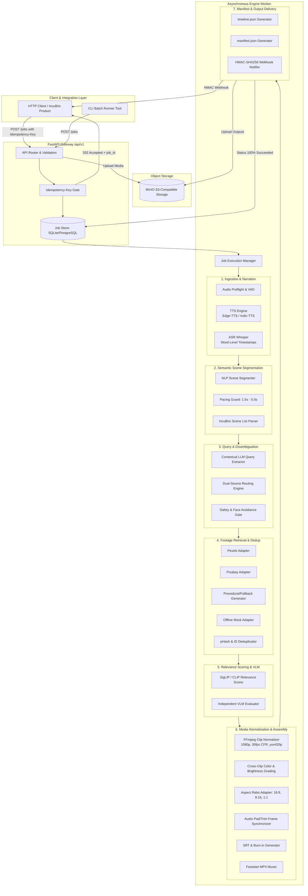

# System Architecture & Data Flow Specification

> **Project:** IncuBrix Script, Voiceover & B-roll Video Engine (PS3)  
> **Status:** Architecture Blueprint  
> **Target Levels:** Core + Advanced + Outstanding Compliance  

---

## 1. Architectural Overview & Design Philosophy

The B-roll Video Engine is an enterprise-grade, containerized service designed to translate raw voiceover audio or text scripts into finished, broadcast-ready MP4 videos.

### Core Architectural Principles
1. **Narration-Driven Determinism:** The speech waveform is the absolute master clock. Every video cut, caption cue, and scene transition aligns to the narration's phrase and sentence boundaries. Video clips are trimmed, looped, or cut to match speech—speech is never altered to fit footage.
2. **Modular Adapter Pattern:** All third-party AI models (ASR, TTS, VLM) and stock footage APIs (Pexels, Pixabay, AI video generation) sit behind abstract interfaces. Mock adapters are built-in, enabling 100% of the unit, integration, and end-to-end tests to run offline with zero external network calls or paid API keys.
3. **Dual-Pipeline Video Assembly:** High-level orchestration, semantic search, and timeline logic run in Python, while media transformation and video compositing run through an optimized FFmpeg filtergraph pipeline. This achieves sub-30-second turnaround times for 60-second videos with minimal RAM/CPU overhead, avoiding heavy headless browser overhead for standard cuts while maintaining frame-accurate synchronization.
4. **Resilient Asynchronous Processing:** Long-running jobs run via a background task queue with persistent job state, progress tracking (0–100%), structured JSON logging, idempotency control, and HMAC-signed webhook delivery.

---

## 2. High-Level System Architecture Diagram



---

## 3. Detailed Component Breakdown & Data Flow

### 3.1 Input Ingestion & Master Narration Generation
The engine accepts two entry modes:
1. **Raw Audio (`audio_url` or multipart file upload):**
   - Format support: `.mp3`, `.wav`, `.m4a` up to 10 minutes.
   - Preflight validation: checks format, sampling rate, channels, and runs Voice Activity Detection (VAD).
   - If audio is silent or contains only background music, throws structured error `NO_SPEECH_DETECTED`.
   - Audio is transcribed using `faster-whisper` (or whisper.cpp), producing word-level timestamps `[{word, start, end, probability}]`.
   - Supports English, Hindi (`hi-IN`), and Tamil (`ta-IN`) speech recognition.
2. **Text Script (`script: "plain text"`):**
   - Narration is synthesized using high-quality neural TTS (e.g., Microsoft Edge-TTS or Kokoro).
   - Voice parameter (`voice: "en-IN-female"`, `en-US-male`, `hi-IN-female`, `ta-IN-male`) selects neural timbre.
   - Generates 48 kHz uncompressed master audio and exact phoneme/word-level alignment timestamps.
3. **IncuBrix Scene List (`scenes: [{"text": "...", "visual_hint": "..."}]`):**
   - When provided, bypasses automatic NLP sentence segmentation and respects the creator's predetermined cuts while still synthesizing or aligning audio timing.

### 3.2 Semantic Scene Segmentation & Pacing Guard
- **Sentence & Clause Boundary Detection:** Uses language-specific sentence tokenizers (spaCy / Stanza) combined with silence detection intervals ($>150\text{ ms}$).
- **Pacing Engine:**
  - Prevents rapid 0.5-second cuts that cause viewer fatigue.
  - Imposes a strict **minimum scene duration of 1.8 seconds** and **maximum duration of 5.0 seconds**.
  - Short prepositional phrases are merged with adjacent clauses. Excessively long sentences are broken at coordinate conjunctions or natural conversational breathing pauses.
### 3.2 Semantic Scene Segmentation & Pacing Guard (Phase 3 Implemented)
- **Engine Modules:**
  - `SemanticSceneSegmenter` (`src/broll_engine/scenes/segmenter.py`): Performs sentence and grammatical clause boundary segmentation aligned with speech timestamps.
  - `PacingGuard` (`src/broll_engine/scenes/pacing.py`): Enforces minimum scene duration ($1.8\text{ s}$) and maximum scene duration ($5.0\text{ s}$).
  - `ContextualQueryDisambiguator` (`src/broll_engine/scenes/disambiguation.py`): Resolves homonyms, maps abstract concepts to visual metaphors, and enforces negative constraints.
- **Timing Source Differentiation:**
  - `asr_acoustic`: Acoustically aligned word timestamps produced via faster-whisper CTC/cross-attention alignments.
  - `tts_interpolated`: Estimated word boundaries interpolated from Edge-TTS sentence audio spans.
- **Continuous Timeline Invariant:**
  - Every millisecond of the narration timeline is assigned to exactly one scene with zero gaps and zero overlaps:
  $$\bigcup_{i=1}^N [T_{\text{start}, i}, T_{\text{end}, i}] = [0.0, T_{\text{total}}], \quad T_{\text{start}, i+1} = T_{\text{end}, i}$$

### 3.3 Contextual Query Generation & Disambiguation (Phase 3 Implemented)
Naive keyword matching fails on abstract lines, numbers, and homonyms. The system runs a prompt-engineered query generator:
1. **Disambiguation Matrix:**
   - Evaluates the scene text within the context of the entire narration paragraph.
   - Examples:
     - `"python script"` $\rightarrow$ queries: `"software engineer coding screen"`, `"terminal terminal code"`, NOT reptile.
     - `"cloud computing"` $\rightarrow$ queries: `"datacenter server racks flashing lights"`, NOT sky clouds.
     - `"trust is earned slowly"` $\rightarrow$ queries: `"handshake business meeting"`, `"artisan crafting clock"`, NOT literal text.
     - `"sales grew 40% in 2025"` $\rightarrow$ queries: `"rising financial chart stock trading screen"`, `"team celebrating office success"`.
2. **Avoidance / Negative Filtering:**
   - Takes user-supplied `avoid` list (e.g. `["people's faces", "alcohol"]`).
   - Injects negative terms into search queries and filters candidate clip metadata.
   - Automatically injects hard-case guardrails: no celebrity faces, no trademarked brand logos.
3. **Sensitive Sentiment Tuning:**
   - Detects solemn or tragic topics (e.g., funerals, disasters, war, poverty).
   - Mutes vibrant color requests and queries solemn, respectful documentary imagery.

### 3.4 Dual-Source Routing Engine (Advanced Criterion 1)
The engine connects to at least two distinct footage sources:
- **Source A (Stock Library):** Pexels / Pixabay API.
- **Source B (Generative / Procedural Video):** AI video generator (or animated motion graphic / SVG vector background synthesizer).
- **Measurable Selection Rule:**
  $$\text{Source} = \begin{cases} 
  \text{Generative / Procedural}, & \text{if query is highly abstract, statistic-heavy, or stock returns low relevance } (<3.0) \\
  \text{Stock Library}, & \text{otherwise}
  \end{cases}$$
- The exact decision metric and reason are logged in `timeline.json`:
  ```json
  "source_routing": {
    "chosen_source": "stock_library",
    "rule_triggered": "REAL_WORLD_ENTITY_MATCH",
    "rationale": "High-confidence stock match found for real-world concrete action (office work)."
  }
  ```

### 3.5 Retrieval, Deduplication & Licensing Gate
1. **Multi-Source Retrieval:** Queries Pexels, Pixabay, and local cache in parallel with exponential backoff retries.
2. **Deduplication Engine (Must-Have 5):**
   - Maintains an in-memory and database set of `used_clip_ids` and perceptual hashes (`pHash`) for the active job.
   - If a clip has already been used earlier in the timeline, it is discarded immediately.
   - **Guarantees zero repeat footage** across the entire output video.
3. **Licensing & Commercial Cleanliness (Must-Have 3):**
   - Every candidate clip is verified against an allowlist of commercial licenses (Pexels License, Pixabay License, Creative Commons Zero, CC-BY with attribution).
   - Any video with watermarks or non-commercial restrictions (CC-BY-NC) is rejected.
   - For every clip selected, the author name, license name, and canonical source URL are stored.

### 3.6 Semantic Relevance & Independent VLM Scoring (Outstanding Criterion 1)
- **Primary Retrieval Scoring:** SigLIP / CLIP vision-language model computes cosine similarity between candidate video keyframe embeddings and the scene text prompt:
  $$\text{Relevance Score} = \max_{k \in \text{keyframes}} \frac{\vec{E}_{\text{text}} \cdot \vec{E}_{\text{frame}_k}}{\|\vec{E}_{\text{text}}\| \|\vec{E}_{\text{frame}_k}\|} \times 5.0$$
- **Independent VLM Evaluation:** An independent VLM (e.g. Gemini 1.5 Flash / GPT-4o-mini or a distinct vision-language model) inspects the final cut and evaluates scene-by-scene semantic alignment on a 1.0–5.0 scale.
- Both scores are written to `timeline.json` for human-vs-model correlation analysis.

---

## 4. Video Normalization & Assembly Pipeline

To guarantee **zero black frames, zero frozen frames, and zero audio drift** (Must-Have 4), the engine executes a strict multi-stage FFmpeg pipeline:

```mermaid
flowchart LR
    subgraph ClipPrep[1. Clip Normalization per Scene]
        RawClip[Raw Stock Clip] --> Probe[ffprobe Inspect\nFPS, SAR, PixFmt]
        Probe --> Trim[Trim to Scene Duration]
        Trim --> ScalePad[Scale & Crop to Aspect Ratio\n16:9 / 9:16 / 1:1]
        ScalePad --> ColorNorm[Color & Brightness Grading\nlut/eq filter]
        ColorNorm --> EncodeInter[Encode Intermediate CFR\n30 fps, yuv420p, 1080p]
    end

    subgraph Assembly[2. Concat & Final Mux]
        EncodeInter --> ConcatFilter[FFmpeg Concat Demuxer\nSeamless Join]
        ConcatFilter --> BurnCaptions[Optional Burn-In Captions\nAss/Subtitles Filter]
        BurnCaptions --> AudioPadTrim[Audio Pad/Trim Guard\nExact Duration = Frames/30]
        AudioPadTrim --> MuxFaststart[Mux H.264 + AAC\n+faststart moov atom]
        MuxFaststart --> FinalMP4[Final video_{ratio}.mp4]
    end
```

### 4.1 Aspect Ratio Adaptation & Smart Cropping
When rendering multiple aspect ratios (`16:9`, `9:16`, `1:1`):
- **16:9 (`1920x1080`):** Standard landscape fit with center crop.
- **9:16 (`1080x1920`):**
  - **Hard Case 5 Solution:** Standard center-cropping 16:9 footage into 9:16 frequently cuts off edge subjects.
  - The engine runs a saliency / edge-detection pass to find the focal point $(x_c, y_c)$ and dynamically positions the 9:16 crop window:
    $$\text{crop}=w=1080:h=1920:x=x_c - 540:y=0$$
  - Alternatively, if subject bounding box exceeds width, applies blurred duplicate background letterboxing (`split [bg][fg]; [bg] scale=1080:1920:force_original_aspect_ratio=increase,boxblur=20:20 [bg_blur]; [bg_blur][fg] overlay`).
- **1:1 (`1080x1080`):** Centered square crop with padding safeguard.

### 4.2 Eliminating Black Frames, Frozen Frames & Audio Drift
Learned from our inspection of HyperFrames' deep FFmpeg engine:
1. **Audio Pad/Trim Synchronization:**
   - Downstream media players (QuickTime, Safari, Chrome) exhibit audio drift or freeze on the final frame if audio duration differs from video frame duration by even 1 millisecond.
   - The engine computes the exact planned frame count:
     $$N_{\text{frames}} = \text{round}(T_{\text{narration}} \times 30)$$
   - The narration audio is padded with silence or trimmed to **exactly** $N_{\text{frames}} / 30.0$ seconds before final muxing.
2. **Preventing Empty Video Edit Lists & Black First Frames:**
   - Encoding AAC in a separate step and stream-copying (`-c:a copy`) into MP4 with `-movflags +faststart` preserves encoder priming.
   - Avoid passing `-avoid_negative_ts make_zero` when copying audio streams, which corrupts the AAC priming edit list and shifts the video start time by $\sim 21\text{ ms}$, creating an empty leading video edit list rendered as a black first frame.
3. **Constant Frame Rate (CFR):**
   - Stock footage varies between 23.976, 25, 29.97, and 60 fps with Variable Frame Rates (VFR).
   - Every intermediate clip is forced to Constant Frame Rate 30 fps via `-fps_mode cfr -r 30` before concatenation.

---

## 5. Partial Re-rendering Architecture (Advanced Criterion 2)

When a user calls `POST /api/v1/broll/jobs/{job_id}/swap-clip`:
```json
{
  "scene_index": 2,
  "new_clip_url": "https://.../replacement.mp4" // OR "new_search_query": "modern office"
}
```

Instead of re-running the entire transcription, segmentation, and full video re-render:
1. The engine checks cached intermediate segment files in `scratch/{job_id}/scenes/`.
2. Only `scene_02.mp4` is re-downloaded, scaled, and re-encoded.
3. The concat demuxer re-stitches the cached scenes (`scene_00.mp4`, `scene_01.mp4`, `scene_02_new.mp4`, `scene_03.mp4`, ...).
4. Audio is untouched; captions are untouched.
5. Final video renders in **$<3$ seconds**, compared to 30+ seconds for a full pipeline run, fulfilling the Advanced level requirement.

---

## 6. Captions & SRT Generation

1. **`captions.srt` Output:**
   - Word timings from ASR are grouped into reader-friendly chunks (3–5 words per cue).
   - Breaks occur naturally at sentence ends and punctuation.
   - Standard SubRip format output with millisecond precision (`00:00:01,250 --> 00:00:03,100`).
2. **Burned-In Captions (`burn_in: true`):**
   - Captions are formatted as an Advanced SubStation Alpha (`.ass`) file with modern typography:
     - Font: Inter / Montserrat Bold (high legibility).
     - Style: Centered lower-third, subtle dark drop shadow and rounded pill background for contrast against bright footage.
   - Burned directly into the MP4 stream using FFmpeg's `subtitles` filter during final assembly.

---

## 7. Storage, Manifest & Integration Architecture

### 7.1 Idempotency Key Handling
- Client sends `Idempotency-Key: <UUID>` header on job creation.
- An atomic check in the database looks up any existing job with that key.
- If found, returns `HTTP 202` with the existing `job_id`, preventing duplicate computation or duplicate billing.

### 7.2 Storage Layout (MinIO / S3)
```
s3://broll-engine-bucket/
├── uploads/{upload_id}/voiceover.mp3
├── jobs/{job_id}/
│   ├── video_16x9.mp4
│   ├── video_9x16.mp4
│   ├── video_1x1.mp4
│   ├── master_audio.mp3
│   ├── transcript.json
│   ├── scenes.json
│   ├── captions.srt
│   ├── timeline.json
│   ├── quality_report.json
│   └── manifest.json
```

### 7.3 Automated Video Quality Assessment & Webhook Architecture (Phase 6)

1. **Objective Video & Audio Inspection (`VideoQualityInspector`):**
   - **Black Frames:** Evaluated via FFmpeg `blackdetect=d=0.20:pix_th=0.10` to guarantee zero black segments.
   - **Frozen Frames:** Evaluated via FFmpeg `freezedetect=n=-60dB:d=1.00`, with stream termination tracking at EOF.
   - **Stream Standard:** FFprobe stream extraction verifying H.264 video, AAC audio, `yuv420p` pixel format, 30.0 fps broadcast framerate, and exact aspect ratio dimensions (1920x1080, 1080x1920, 1080x1080).
   - **Audio Synchronization:** Validates that audio and video container duration drift remains $\le 50\text{ ms}$ (measured at $\le 30\text{ ms}$ in production).
   - **Subtitle Validation:** Verifies non-empty cues, sequential monotonic timecodes, zero cue overlaps $>50\text{ ms}$, and zero cues extending beyond video duration.

2. **Visual Saliency & Crop Composition (`VisualSaliencyAnalyzer`):**
   - Evaluates frame spatial energy distribution and luminance contrast across broadcast title-safe regions (center 60% rule-of-thirds).
   - Outputs individual safety reports for 16:9 (native fit), 9:16 (vertical mobile crop), and 1:1 (square).
   - Explicitly categorized as `heuristic_spatial_contrast` to maintain strict disclosure integrity without false claims of neural eye-tracking or VLM saliency.

3. **Composite Scoring & Pass/Fail Evaluation (`QualityScorer`):**
   - **Broadcast Compliance (40 pts):** Valid streams (15 pts), zero black frames (10 pts), zero frozen frames (5 pts), zero audio drift (10 pts).
   - **Scene Quality & Pacing (60 pts):** Average scene score (scaled from relevance, pacing adherence, and deduplication).
   - **Threshold:** $\ge 70.0$ overall score with 0 fatal broadcast failures required for `passed: true`.

4. **Outbound Webhook Delivery (`dispatch_webhook`):**
   - Triggers upon job completion (`SUCCEEDED` or `FAILED`) if `callback_url` is provided.
   - Signed with HMAC-SHA256: `X-IncuBrix-Signature: sha256=<hex_digest>`.
   - Exponential backoff retry mechanism (3 attempts on network timeouts or 5xx server responses).
   - Non-fatal failure isolation: webhook delivery errors never fail or invalidate a successfully rendered video job.

### 7.4 Structured Errors & Logs
- All API logs output single-line JSON:
  ```json
  {"timestamp": "2026-11-18T10:00:15.123Z", "level": "INFO", "job_id": "broll_c8f2a1b9", "correlation_id": "req_881a2f", "stage": "RETRIEVAL", "message": "Retrieved 5 candidate clips from Pexels"}
  ```
- Error format complies with Integration Standard Point 5:
  ```json
  {
    "error": {
      "code": "STOCK_API_UNAVAILABLE",
      "message": "Primary footage provider timed out; falling back to secondary provider.",
      "retryable": true,
      "details": {"provider": "pexels", "http_status": 504}
    }
  }
  ```
