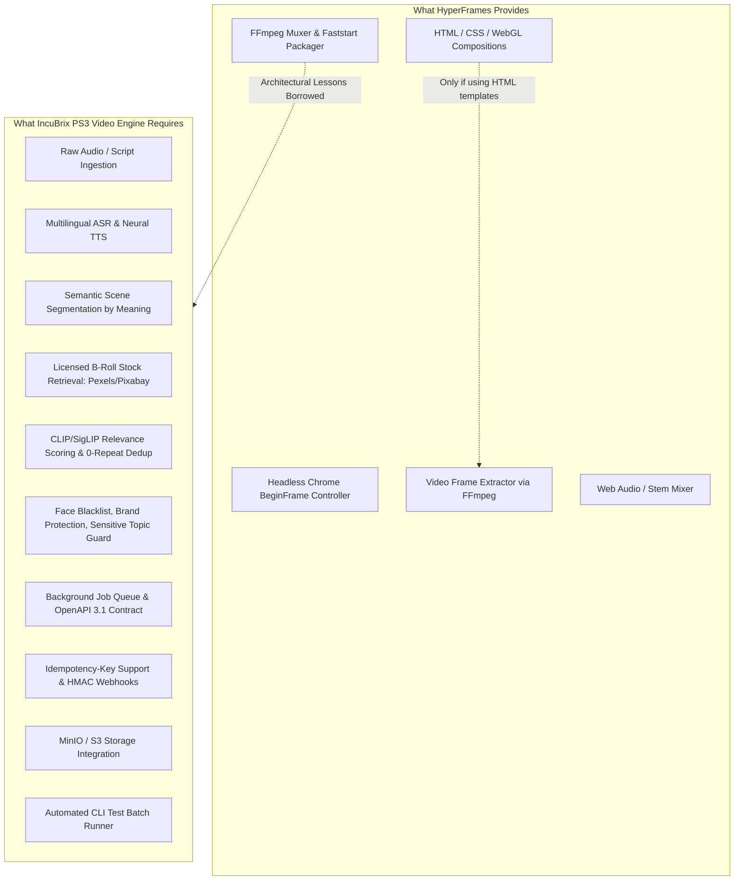
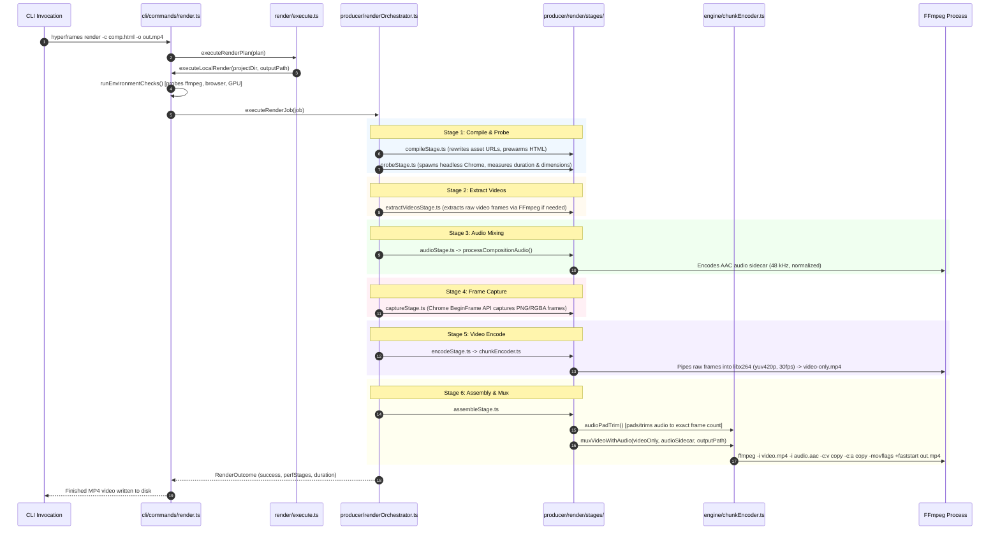

# HyperFrames In-Depth Source Code Analysis & Architecture Teardown

> **Repository Analyzed:** `references/hyperframes/` (Commit ref: `main`)  
> **Source Project:** [heygen-com/hyperframes](https://github.com/heygen-com/hyperframes)  
> **License:** Apache License 2.0 (Copyright 2026 HeyGen, Inc.)  
> **Purpose:** Technical investigation of HyperFrames internals, component reuse analysis, and rendering pipeline tracing for IncuBrix PS3.

---

## 1. Executive Summary: What HyperFrames Actually Is

HyperFrames is an open-source framework developed by HeyGen designed for turning **HTML, CSS, media, and seekable JavaScript animations into deterministic MP4 videos**.

Its core innovation is replacing traditional timeline video editors (like Premiere or After Effects) with a headless web rendering engine driven by Google Chrome's experimental `BeginFrame` CDP (Chrome DevTools Protocol) API. It allows AI coding agents to author videos using web technologies (DOM elements, GSAP timelines, WebGL shaders, CSS styling) and render them frame-by-frame to video.

### What HyperFrames Provides vs. What PS3 Requires



HyperFrames is a **composition rendering framework**, not an **autonomous B-roll generator**. It has no concept of semantic scene segmentation, stock footage retrieval APIs, duplicate clip prevention, licensing metadata verification, or background REST APIs with idempotency keys.

---

## 2. Package Monorepo Structure

HyperFrames is structured as a Bun/TypeScript monorepo with 16 distinct packages under `packages/`:

| Package | Purpose & Architecture | Reuse Potential for PS3 |
| :--- | :--- | :--- |
| **`@hyperframes/cli`** | CLI entry point (`hyperframes render`, `transcribe`, `measure`). Orchestrates local preflight checks, GPU probing, and render plans. | **Reference Only:** Shows how to run preflight environment checks and handle FFmpeg discovery. |
| **`@hyperframes/core`** | Core abstractions, timeline variables, audio group definitions, caption transformation helpers (`captionTransform.ts`). | **High Conceptual Value:** Models for caption cueing and audio group volume envelopes. |
| **`@hyperframes/engine`** | Low-level media engine: Puppeteer browser lease pools, FFmpeg chunk encoders, AAC encoding, audio mixer (`audioMixer.ts`), and frame extraction (`videoFrameExtractor.ts`). | **High Architectural Value:** Contains critical FFmpeg flags and race-condition workarounds for zero black frames. |
| **`@hyperframes/producer`** | In-process render orchestrator (`renderOrchestrator.ts`). Sequences the 6-stage rendering pipeline from compilation through assembly. | **High Value:** Serves as a reference design for stage-based pipeline orchestration. |
| **`@hyperframes/player`** | Web Component for previewing compositions interactively in browser DOM. | **Not Needed:** PS3 outputs standalone MP4 video files. |
| **`@hyperframes/parsers`** | AST parsers (Babel/Acorn/Recast) for rewriting HTML compositions and script tags. | **Not Needed:** PS3 does not parse JavaScript ASTs. |
| **`@hyperframes/studio`** | Desktop React-based video editing studio. | **Not Needed:** PS3 is a headless containerized backend service. |
| **`@hyperframes/shader-transitions`** | WebGL GLSL shader transitions (cross-dissolves, wipes, luma mattes). | **Optional Reference:** Can inform transition effects if needed. |
| **`@hyperframes/aws-lambda` / `gcp-cloud-run`** | Serverless adapters for distributed multi-chunk rendering. | **Reference Only:** PS3 uses Docker Compose. |

---

## 3. End-to-End Rendering Pipeline Trace: CLI to MP4

Let us trace the exact code path when `hyperframes render` is invoked, based on inspecting the source code:



### Detailed Trace of Key Files & Lines:

1. **Entry Point (`packages/cli/src/commands/render.ts`):**
   - Dispatches `renderLocal(projectDir, outputPath, options)`.
   - Spawns `runEnvironmentChecks()` to probe `ffmpeg`, `ffprobe`, and Chrome headless shell paths.
   - Probes H.264 capabilities via `detectH264EncoderModeForRender()`.
   - Invokes `loadProducer()` to dynamically import `@hyperframes/producer`.
2. **Orchestrator (`packages/producer/src/services/renderOrchestrator.ts`):**
   - Entry point: `executeRenderJob(job)`.
   - Sets up scratch directory `RENDER_JOB_DIR` and observability samplers.
   - Coordinates the 6 core stages:
     - `compileStage(input)`: Localizes remote media and fonts.
     - `probeStage(input)`: Puppeteer loads DOM, evaluates GSAP timelines, and resolves actual composition duration.
     - `extractVideosStage(input)`: Pre-extracts embedded `<video>` frames using FFmpeg to avoid browser decoder lag.
     - `audioStage(input)`: Merges audio tracks, applies volume automation, and encodes an AAC sidecar.
     - `captureStage(input)`: Steps Chrome frame-by-frame via `HeadlessExperimental.beginFrame` CDP protocol.
     - `encodeStage(input)`: Encodes captured frames into intermediate video using FFmpeg `libx264` (`-pix_fmt yuv420p`).
     - `assembleStage(input)`: Final muxing and metadata alignment.
3. **Audio-Video Synchronization (`packages/producer/src/services/render/audioPadTrim.ts`):**
   - Computes expected duration: $T_{\text{expected}} = N_{\text{frames}} / \text{FPS}$.
   - Trims or pads audio with silence if duration differs by more than $0.001\text{ seconds}$ ($1\text{ ms}$).
   - **Crucial Lesson:** Prevents QuickTime and Safari from freezing on the final frame or cutting off ending audio.
4. **Final Assembly & Muxing (`packages/engine/src/services/chunkEncoder.ts`):**
   - Function: `muxVideoWithAudio(videoPath, audioPath, outputPath)`.
   - Executes:
     ```bash
     ffmpeg -i video_only.mp4 -i audio.aac -c:v copy -c:a copy -movflags +faststart output.mp4
     ```
   - **Crucial Lesson:** Do **not** pass `-avoid_negative_ts make_zero` when stream-copying audio. Doing so strips the AAC priming edit list, pushing the video start time forward by $\sim 21\text{ ms}$, creating an empty leading video edit list that renders as a black first frame.

---

## 4. Audio Handling & Speech Transcription in HyperFrames

HyperFrames includes speech transcription via `packages/cli/src/api/transcribe.ts`:
- Wraps local **Whisper** CLI, **Sherpa-ONNX**, or **Parakeet-MLX**.
- Writes word-level transcript arrays: `[{id: "w0", text: "Hello", start: 0.0, end: 0.5}, ...]`.
- Converts word timings into WebVTT (`.vtt`) or SubRip (`.srt`) files (`formatSrt` in `normalize.ts`).
- Provides caption animation presets (kinetic slam, karaoke pill highlight, editorial emphasis) implemented as GSAP animations inside HTML DOM elements.

### Limitations of HyperFrames Audio:
- **No Text-to-Speech:** HyperFrames does not generate speech from text script input; it assumes the creator already has an audio file or calls HeyGen's proprietary cloud API (`transcribeWithHeygen`).
- **No Scene Segmentation:** HyperFrames groups words into captions (2–5 words), but **does not perform semantic scene segmentation** to choose when to cut video clips.
- **Whisper Hallucination Flaws:** Documented in `skills/hyperframes/references/captions.md`: Whisper invents *"Thank you"* over silent tails, requiring explicit silence detection (`silencedetect=noise=-35dB:d=0.6`).

---

## 5. What We Can Reuse vs. What Must Be Built Independently

| Engine Functionality | HyperFrames Component | PS3 Decision | Implementation Strategy |
| :--- | :--- | :--- | :--- |
| **Audio-Video Frame Sync** | `audioPadTrim.ts` logic in `@hyperframes/producer` | **Reuse Architectural Logic** | Port the pad/trim algorithm to Python: pad/trim audio to `round(T * 30) / 30.0` to eliminate drift. |
| **FFmpeg Mux & Faststart** | `muxVideoWithAudio` in `@hyperframes/engine` | **Reuse Exact Parameters** | Use identical FFmpeg flags: `-c:v copy -c:a copy -movflags +faststart`, avoiding `-avoid_negative_ts make_zero`. |
| **Color & Format Normalization** | `proxyTranscoder.ts` in `@hyperframes/studio-server` | **Reuse Filter Concept** | Standardize all input clips to `1080p`, constant 30 fps CFR, and `yuv420p` pixel format before concatenation. |
| **Caption Formatting** | `formatSrt` in `whisper/normalize.ts` | **Reuse Logic** | Group ASR words into 3–5 word subtitle cues with SubRip timestamp formatting. |
| **Speech-to-Text (ASR)** | `api/transcribe.ts` | **Build Independently** | Use Python `faster-whisper` (CTranslate2) for native, faster multilingual transcription. |
| **Speech Synthesis (TTS)** | None (HeyGen proprietary) | **Build Independently** | Implement `edge-tts` adapter supporting English, Hindi, and Tamil voices. |
| **Semantic Segmentation** | None | **Build Independently** | Implement NLP sentence tokenizer + silence-aware boundary aligner. |
| **B-Roll Stock Retrieval** | None (manual curl in agent skill) | **Build Independently** | Implement async clients for Pexels and Pixabay with rate limiting and fallback. |
| **Relevance & VLM Scoring** | None | **Build Independently** | Implement SigLIP / CLIP keyframe cosine similarity and independent VLM evaluation. |
| **Deduplication Engine** | None | **Build Independently** | Implement clip ID registry and perceptual hash (`pHash`) tracking to guarantee 0 repeats. |
| **Background Jobs & REST API**| None (HyperFrames is CLI only) | **Build Independently** | Implement FastAPI with OpenAPI 3.1, `Idempotency-Key`, structured logs, and HMAC webhooks. |
| **Storage & Manifest** | None | **Build Independently** | Implement MinIO S3 client and comprehensive `manifest.json` provenance generator. |

---

## 6. Architectural Conclusion

HyperFrames is a desktop and cloud rendering tool for HTML/CSS canvas animations. However, **using HyperFrames as the primary video renderer for PS3 would introduce unnecessary architectural fragility and resource bloat**:
1. Spawning headless Chrome (`puppeteer`) inside Docker requires extensive shared memory (`--shm-size=2gb`), high RAM ($>2\text{ GB}$ per instance), and causes slow startup times.
2. IncuBrix PS3's core deliverable is **voiceover-to-B-roll assembly**, which consists of trimming, scaling, color-grading, captioning, and concatenating live-action stock video clips.
3. **FFmpeg performs this natively in C/Assembly in 10–20 seconds with $<150\text{ MB}$ RAM**, whereas HyperFrames' browser-screenshot pipeline takes 60–120+ seconds with high memory overhead.

**Recommended Strategy:**
We adopt HyperFrames' proven **media normalization, frame-rate synchronization, and FFmpeg parameter best practices** (preventing black frames and audio drift), while building the B-roll Engine in Python to deliver a high-performance, robust, and containerized solution.
