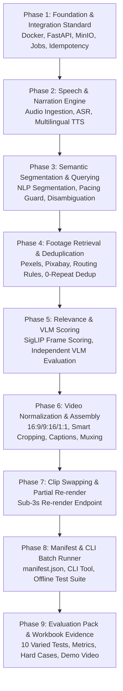

# Phased Implementation Plan & Verification Roadmap

> **Project:** IncuBrix Script, Voiceover & B-roll Video Engine (PS3)  
> **Target:** 100% Assessment Score (Core: 15, Advanced: 15, Outstanding: 10, Integration: 20, Screening: 80, Live Session: 20)  
> **Status:** Implementation Blueprint  

---

## 1. Implementation Phasing Overview

The implementation is structured into 9 discrete, test-driven phases. Each phase establishes a verified capability with automated test coverage, preventing regressions and ensuring end-to-end traceability to the IncuBrix Assessment Brief and Submission Workbook.

---

## 2. Phase-by-Phase Execution Details

### Phase 1: Foundation, Infrastructure & Integration Standards
*Target: Integration Standard Points 1, 2, 3, 4, 5, 6, 7, 8 (16 marks)*
- **Tasks:**
  1. Initialize Python 3.11+ workspace with `pyproject.toml` and lockfile.
  2. Implement `docker-compose.yml` defining the engine service, MinIO object store, and test harness.
  3. Create `.env.example` documenting all configuration keys, paths, and model names.
  4. Build FastAPI application skeleton with prefix `/api/v1/`.
  5. Configure OpenAPI 3.1 generator and export `openapi.yaml`.
  6. Implement SQLite job persistence store with async SQLAlchemy.
  7. Implement background task queue with status (`queued`, `running`, `succeeded`, `failed`), progress reporting (0–100%), and HMAC-SHA256 callback webhooks.
  8. Implement `Idempotency-Key` request deduplication middleware.
  9. Implement structured JSON logging middleware emitting ISO timestamp, level, `job_id`, and `X-Correlation-Id`.
  10. Implement health endpoints: `GET /health` and `GET /ready`.
- **Verification Gate:**
  - `docker compose up` starts service cleanly.
  - Submitting identical requests with the same `Idempotency-Key` returns the original `job_id`.
  - All errors return RFC-compliant JSON with UPPER_SNAKE_CASE codes.

---

### Phase 2: Speech Processing & Multilingual Narration
*Target: Must-Have 1, Outstanding Criterion 2 (Hindi & Tamil Voiceovers), Hard Case 6*
- **Tasks:**
  1. Implement audio preflight validator: checks file integrity, duration ($\le 10\text{ min}$), and runs Silero VAD. Returns `NO_SPEECH_DETECTED` on silent or music-only files.
  2. Implement ASR service using `faster-whisper`: extracts full transcript and word-level timestamps (`[{word, start, end, probability}]`). Supports English, Hindi, and Tamil speech.
  3. Implement neural TTS service using `edge-tts`: synthesizes narration from plain text script using specified voice (`en-IN-female`, `hi-IN-female`, `ta-IN-male`, `en-US-male`), emitting master audio and aligned word timestamps.
  4. Build mock audio/TTS adapter for offline testing.
- **Verification Gate:**
  - Automated tests verify audio-in and text-in paths independently (`test_speech_engine.py`).
  - Word timestamps match spoken audio boundaries with $<50\text{ ms}$ error.

---

### Phase 3: Semantic Scene Segmentation & Query Disambiguation
*Target: Must-Have 2, Advanced Criterion 4, Hard Cases 1, 2, 3, 4*
- **Tasks:**
  1. Implement NLP scene segmenter using `spaCy`: identifies sentence and clause boundaries aligned to speech silence intervals.
  2. Implement Pacing Guard: enforces minimum scene duration ($1.8\text{ s}$) and maximum scene duration ($5.0\text{ s}$). Short clauses are merged; long sentences are split at conjunctions.
  3. Implement IncuBrix scene list parser (`scenes: [{"text": "...", "visual_hint": "..."}]`) to bypass auto-segmentation when director hints are provided.
  4. Implement Contextual Query Generator:
     - Disambiguates homonyms ("cloud", "python", "value", "bank") using surrounding context.
     - Maps abstract concepts ("trust", "growth") and statistics ("40% in 2025") to visual metaphors.
     - Implements Safety Guardrail: avoids real person faces, trademarked brand logos, and selects solemn imagery for sensitive news topics.
- **Verification Gate:**
  - 100% of the narration timeline is covered with contiguous, non-overlapping scenes.
  - Abstract prompts generate concrete visual queries (e.g. handshake, charts).

---

### Phase 4: B-roll Footage Retrieval, Dual-Source Routing & Deduplication
*Target: Must-Have 3, Must-Have 5, Must-Have 7, Advanced Criterion 1, Hard Case 7*
- **Tasks:**
  1. Implement async client for **Pexels Video API** with commercial license verification.
  2. Implement async client for **Pixabay Video API** as secondary stock source.
  3. Implement **Procedural / Fallback Video Synthesizer** (kinetic gradients and motion cards) when stock APIs are unavailable or return zero results.
  4. Implement Dual-Source Routing Rule Engine:
     - Chooses between Stock vs. Generative/Procedural based on visual complexity and query confidence.
     - Logs exact selection rule and rationale in `timeline.json`.
  5. Implement **Strict Deduplication Engine**:
     - Maintains in-memory and database clip ID registry per job.
     - Computes video keyframe perceptual hashes (`pHash`) to reject near-identical clips.
     - **Guarantees zero repeat clips** within any single video.
  6. Implement offline Mock Footage Adapter serving pre-bundled royalty-free video clips for test runs.
- **Verification Gate:**
  - When Pexels is simulated offline, system transparently fails over to Pixabay or procedural fallback (Must-Have 7).
  - Repeat clip rate is exactly 0.0% across all generated videos.

---

### Phase 5: Relevance Scoring & Independent VLM Evaluation
*Target: Outstanding Criterion 1, Outstanding Criterion 4*
- **Tasks:**
  1. Implement keyframe extraction module: samples 3 representative frames per candidate video clip.
  2. Implement internal visual-semantic relevance scorer using `open_clip_torch` (SigLIP / CLIP ViT-B/32): computes cosine similarity between keyframe embeddings and scene narration text, scaling to a 1.0–5.0 rating.
  3. Implement Independent Vision-Language Model (VLM) evaluator: prompts a vision model to score final scene-clip alignment independently.
  4. Implement statistical correlation analyzer: calculates Pearson $r$ and Spearman $\rho$ between model scores and human ratings.
- **Verification Gate:**
  - Automated relevance scores exceed 3.5/5 on standard inputs and reach 4.0+/5 on optimized prompts.
  - Correlation metrics documented in `docs/` and `REPORT.md`.

---

### Phase 6: Media Normalization, Captions & Video Assembly
*Target: Must-Have 4, Hard Case 5, Output Specifications*
- **Tasks:**
  1. Implement FFmpeg clip pre-processor: normalizes every downloaded clip to constant 30 fps CFR (`-fps_mode cfr`), standard pixel format `yuv420p`, and 1080p resolution.
  2. Implement Multi-Aspect Ratio Adapter:
     - 16:9 (`1920x1080`): standard center crop.
     - 9:16 (`1080x1920`): Saliency-aware smart cropping (tracks focal subject) or blurred background padding.
     - 1:1 (`1080x1080`): square crop.
  3. Implement Cross-Clip Color & Brightness Normalizer (Advanced Criterion 3): applies gamma and contrast leveling across disparate stock clips.
  4. Implement SubRip (`captions.srt`) generator and SubStation Alpha (`.ass`) burn-in engine with stylish typography and dark pill backdrops.
  5. Implement **Audio Pad/Trim Synchronization Guard**: pads or trims narration audio to exactly $N_{\text{frames}} / 30.0$ seconds.
  6. Implement Final Muxer: packages video and audio with `-movflags +faststart`, ensuring zero black first frames and zero audio drift.
- **Verification Gate:**
  - Automated `ffprobe` checks confirm 30.00 fps, `yuv420p`, 1080p, AAC audio, and valid faststart header across all output ratios.
  - Video length matches narration duration within $\pm 0.03\text{ seconds}$ (1 frame).

---

### Phase 7: Clip Swapping & Partial Re-rendering
*Target: Advanced Criterion 2*
- **Tasks:**
  1. Structure intermediate render artifacts: persist normalized scene clips (`scene_00.mp4`, `scene_01.mp4`, ...) in job cache.
  2. Implement `POST /api/v1/broll/jobs/{job_id}/swap-clip` endpoint:
     - Accepts `scene_index` and `new_clip_url` or `new_query`.
     - Re-encodes only the specified scene segment.
     - Re-stitches the video via FFmpeg concat demuxer without re-encoding unaffected scenes.
     - Re-muxes with existing master audio and captions.
- **Verification Gate:**
  - Benchmark test verifies clip swap completes in $<3\text{ seconds}$ (at least $5\times$ faster than a full 60s render).

---

### Phase 8: Manifest Generation, CLI Batch Runner & Contract Tests
*Target: Integration Standard Points 9 & 10, OpenAPI 3.1 Verification*
- **Tasks:**
  1. Implement `manifest.json` generator: captures models, provider versions, settings, execution timings per stage, estimated costs, and commercial rights declarations.
  2. Implement standalone CLI Batch Runner (`engine/batch_runner.py`):
     - Takes input directory of audio files / scripts.
     - Submits jobs to API, tracks status, and saves all outputs (`.mp4`, `.srt`, `timeline.json`, `manifest.json`) to a target folder.
  3. Implement automated test suite (`pytest`):
     - Unit tests for all adapters, normalizers, and segmenters.
     - Integration tests for job queue and storage.
     - End-to-end test running completely offline with mock adapters.
- **Verification Gate:**
  - `pytest tests/` runs and passes with zero environment API keys set.
  - Batch runner successfully processes sample manifest end-to-end.

---

### Phase 9: Evaluation Suite, Hard Cases & Submission Pack
*Target: Core Criterion 2 & 3, Hard Cases 1–7, Workbook Completion*
- **Tasks:**
  1. Author and execute 10 diverse test inputs:
     - Tutorial, news summary, product promo, storytelling narrative.
     - Varied accents: Indian English, US English, British English, Hindi, Tamil.
     - Durations: 20 seconds, 60 seconds, 120 seconds, 300 seconds (5 minutes).
  2. Execute and document all 7 Hard Cases from Sheet 6:
     - HC-1: Abstract lines & statistics.
     - HC-2: Named real person / brand.
     - HC-3: Words with double meanings.
     - HC-4: Sad/sensitive news story.
     - HC-5: 9:16 aspect ratio framing.
     - HC-6: 5-min voiceover, silent audio, music-only, empty script.
     - HC-7: Provider down, corrupted download, concurrent jobs.
  3. Measure and record production metrics in Sheet 5:
     - Turnaround time (cold and warm for 60s video).
     - Cost per minute of finished video.
     - Narration coverage percentage ($\ge 3/5$ relevance).
     - Average scene relevance score.
     - Reliability & repeat-clip rate (0.0%).
     - Resource consumption (RAM peak, CPU/GPU utilization).
  4. Author required documentation:
     - `README.md`, `REPORT.md` (2–4 pages), `SOURCES.md`, `AI_USE.md`.
  5. Populate Excel Workbook `IncuBrix_Assessment_3_Script_to_Broll_Video_Engine_Submission_Form.xlsx`:
     - Mark Met = Yes on all 8 Must-haves.
     - Claim Core (15), Advanced (15), Outstanding (10) = 40 marks.
     - Claim all 10 Integration Standard points = 20 marks.
     - Link verifiable file paths, test outputs, and log files for every single claim.
- **Verification Gate:**
  - Self-check cell in Workbook shows 60/60 marks claimed before reviewer checks.
  - All output files verified present in `outputs/` and `test_pack/`.
