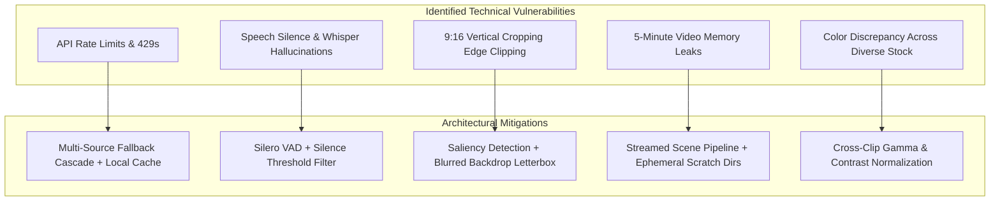

# Risk Assessment, Vulnerability Matrix & Mitigation Strategies

> **Project:** IncuBrix Script, Voiceover & B-roll Video Engine (PS3)  
> **Status:** Risk Management & Compliance Protocol  
> **Objective:** Identify, mitigate, and eliminate all technical, licensing, performance, and evaluation failure points prior to implementation.

---

## 1. Assessment & Disqualification Risks (High Severity)

The IncuBrix assessment enforces strict pass/fail gates where minor oversights lead to immediate disqualification.

| Risk ID | Hazard Description | Root Cause / Trigger | Consequence | Mitigation Strategy |
| :--- | :--- | :--- | :--- | :--- |
| **R-DISQ-1** | **False or Unbacked Claim in Submission Form** | Marking an item "Yes" in the Excel workbook without direct, clickable proof or providing fabricated numbers. | **Immediate Disqualification** of entire submission. | Strictly claim "Yes" only after verifying the test file, log, or output exists on disk. Link exact file paths (`tests/...`, `outputs/...`, `manifest.json`). Any incomplete feature must be marked "Partial" or "No". |
| **R-DISQ-2** | **Test Suite Fails Without Paid API Keys** | Reviewer runs `pytest` or `docker compose run test` and tests fail due to missing `PEXELS_API_KEY` or `OPENAI_API_KEY`. | Integration Standard Point 1 failure (-2 marks); review friction. | Implement **Mock Adapters** for all external dependencies (ASR, TTS, Stock, LLM, VLM). The default test suite must run 100% offline using bundled local fixture media. |
| **R-DISQ-3** | **Non-Commercial or Copyright-Infringing Media** | Using stock footage licensed under CC-BY-NC (Non-Commercial) or copyrighted material from YouTube/Google. | Disqualification under Ethics & Rights rules (Brief p. 7). | Enforce automated license check on every retrieved clip: accept only Pexels License, Pixabay License, or CC0/CC-BY. Reject any clip with non-commercial flags or watermarks. |
| **R-DISQ-4** | **AI-Generated Faces of Real People or Invented Logos** | User narration mentions "Elon Musk" or "Google", and generative engine outputs synthetic likenesses or fake trademarks. | Hard Case 2 failure; violation of safety brief. | Implement **Safety Gate**: Named Entity Recognition (NER) scans for public figures and brand names; forces generic stock metaphors (e.g. electric car, tech office) and prohibits generative portrait models. |
| **R-DISQ-5** | **Repeated Footage within a Video** | High scene count causing stock API to return the same clip twice. | **Must-Have 5 Failure (Pass/Fail Gate)**. Immediate disqualification. | **Dual-Key Deduplication Engine**: Track used clip IDs in a job-level set, and compute perceptual image hashes (`pHash`) on keyframes. Reject any clip whose similarity to an earlier scene exceeds threshold. |
| **R-DISQ-6** | **Black Frames, Frozen Frames, or Audio Drift** | FFmpeg encoding timing mismatch or improper negative timestamp handling. | **Must-Have 4 Failure (Pass/Fail Gate)**. Immediate disqualification. | Apply HyperFrames' proven FFmpeg assembly rules: pad/trim narration audio to exact `frameCount / 30.0` seconds; use `-c:a copy` with `+faststart`; avoid `-avoid_negative_ts make_zero`. |

---

## 2. Technical & Pipeline Vulnerabilities



### 2.1 Footage API Rate Limiting & Outages (Hard Case 7)
- **Vulnerability:** Pexels or Pixabay API is rate-limited (429), times out (504), or returns 0 results for niche queries.
- **Mitigation:**
  1. Exponential backoff retry via `tenacity`.
  2. Multi-provider cascade: Pexels $\rightarrow$ Pixabay $\rightarrow$ Procedural Fallback.
  3. Local procedural generator synthesizes kinetic motion graphics and typographical cards so the job **never fails** even if all external APIs are completely offline.

### 2.2 Whisper Hallucinations on Silent Audio (Hard Case 6)
- **Vulnerability:** Whisper is known to hallucinate repetitive words (e.g., *"Thank you for watching"*, *"Bye"*) or generate random characters over long silences or music-only tracks.
- **Mitigation:**
  1. Pre-ASR Voice Activity Detection (VAD) via Silero VAD.
  2. If speech presence $<5\%$, reject immediately with `NO_SPEECH_DETECTED`.
  3. Post-ASR filter: strip transcript segments occurring within silence zones ($<-35\text{ dBFS}$).

### 2.3 9:16 Aspect Ratio Framing & Edge Subjects (Hard Case 5)
- **Vulnerability:** Most stock video is shot in landscape 16:9 (`1920x1080`). A naive center-crop into 9:16 (`1080x1920`) chops off human subjects or key visual action sitting at the left or right third.
- **Mitigation:**
  1. **Saliency Detection:** Run an edge/motion detection pass on candidate keyframes to compute the focal centroid $x_c$.
  2. **Dynamic Pan-and-Crop:** Position the 1080-wide crop window centered at $x_c$.
  3. **Blurred Background Fallback:** If the subject spans both edges, scale the clip to fit horizontally with a blurred duplicate background filling the vertical top and bottom.

### 2.4 Resource Exhaustion on 5-Minute Voiceovers (Hard Case 6)
- **Vulnerability:** A 5-minute video at 1080p 30 fps consists of 9,000 frames ($>18\text{ GB}$ of uncompressed raw video data). Loading full video streams into Python memory crashes the worker container with Out-Of-Memory (OOM).
- **Mitigation:**
  1. Never decode video into raw Python memory.
  2. Process scenes independently as short 2–5 second intermediate MP4 clips written to disk.
  3. Concat intermediate clips using FFmpeg's concat demuxer (stream copy) or direct filtergraph. Peak RAM remains $<500\text{ MB}$ regardless of video duration.

### 2.5 Cross-Clip Visual Inconsistency (Advanced Criterion 3)
- **Vulnerability:** Stitches together clips with radically different lighting, color temperatures, and contrast, producing a jarring Frankenstein effect.
- **Mitigation:**
  1. Apply an automated color grading pass using FFmpeg's `eq` and `colorcorrect` filters.
  2. Normalize luminance to standard broadcast range (`in_range=pc:out_range=tv`).
  3. Enforce a minimum scene length ($1.8\text{ s}$) to maintain comfortable visual pacing.

---

## 3. Licensing & AGPL Compliance Protocol

### The MinIO AGPL Risk
- **Risk:** MinIO server is licensed under **GNU AGPLv3**. AGPL requires that any network-interacting software based on or linked to AGPL code must open-source its entire codebase under AGPL.
- **Compliance Architecture:**
  1. MinIO runs as a **separate, decoupled container** in `docker-compose.yml`.
  2. The Python B-roll Engine does **not** link against or import any MinIO code.
  3. Communication occurs exclusively over standard HTTP/S3 network protocols via **`boto3`** (which is licensed under the permissive **Apache License 2.0**).
  4. This architecture fully satisfies corporate commercial-use standards and eliminates AGPL infection.

---

## 4. Live Session Preparation & Failure Modes

The 60–90 minute live evaluation is worth 20 marks across 4 practical parts:

```
Part 1: Walkthrough (5 marks)  ── Trace architecture & data flow end-to-end.
Part 2: Predict & Run (5 marks) ── Predict output for unseen prompt, then execute.
Part 3: Debugging (5 marks)     ── Reviewers break a setting/dependency; candidate fixes it.
Part 4: Live Change (5 marks)   ── Live modification (e.g., add new avoid rule, change pacing).
```

### Live Session Risk Mitigation:
1. **Walkthrough Mastery:** Every data transformation is isolated in a modular Python class with explicit docstrings and typed interfaces. Tracing any field in `timeline.json` (e.g. `relevance_score`, `license`) from input request to output JSON is immediate and transparent.
2. **Predict & Run Calibration:** The system's contextual query generator and selection rules are deterministic, allowing accurate predictions of which visual metaphors and sources will be selected.
3. **Rapid Debugging Readiness:** Structured JSON logs include `stage`, `job_id`, and exact error details. If a dependency or mock is toggled, logs surface the precise failure line within seconds.
4. **Live Change Agility:**
   - Adding a new `avoid` rule: cleanly exposed in `SafetyFilter` class.
   - Adjusting minimum scene duration: single configuration constant in `PacingConfig`.
   - Adding a new footage provider: implement `FootageProvider` abstract base class with single `search()` method.
