# Technology Stack Selection & Technical Reasoning

> **Project:** IncuBrix Script, Voiceover & B-roll Video Engine (PS3)  
> **Status:** Architecture Blueprint & Technology Decision Record  
> **Evaluation Standards:** IncuBrix Integration Standard & Outstanding Level Criteria  

---

## 1. Core Language & Runtime: Python 3.11+ / 3.12

### Decision: Python 3.11+ over Node.js / Bun
While HyperFrames demonstrates what is possible in TypeScript for browser-based animation rendering, our B-roll Video Engine's primary workload is **semantic retrieval, speech analysis, multilingual processing, computer vision scoring, and media pipeline orchestration**.

| Evaluation Criterion | Python 3.11+ (Chosen) | Node.js / TypeScript (HyperFrames) | Architectural Verdict |
| :--- | :--- | :--- | :--- |
| **Speech-to-Text (ASR)** | `faster-whisper` (CTranslate2) runs 4x faster on CPU/GPU with native word-level timestamps. | Requires wrapping Whisper CLI / sherpa-onnx binary via child process. | **Python Wins:** Native CTranslate2 bindings provide lower latency and zero IPC overhead. |
| **Text-to-Speech (TTS)** | `edge-tts` provides high-fidelity multilingual neural voices (English, Hindi, Tamil) with zero API fees. | Fragmented TTS ecosystem; largely relies on external proprietary SaaS APIs. | **Python Wins:** Built-in support for Indian languages (Hindi & Tamil) out of the box. |
| **Vision-Language Scoring (VLM)** | Native PyTorch, `open_clip_torch`, and Hugging Face `transformers` (SigLIP, CLIP). | Extremely heavy; requires ONNX Runtime or offloading to cloud endpoints. | **Python Wins:** Local, deterministic embedding computation for scene-to-clip relevance scoring. |
| **NLP & Disambiguation** | `spaCy`, `nltk`, and fast regex sentence boundary tokenizers. | Limited multilingual NLP tokenization libraries. | **Python Wins:** Robust sentence boundary detection across English, Hindi, and Tamil. |
| **FFmpeg Orchestration** | Clean subprocess / `ffmpeg-python` pipelines with direct stream manipulation. | Child process spawning with complex buffer piping. | **Tie:** Both drive FFmpeg binaries effectively. |
| **API & OpenAPI 3.1** | `FastAPI` + `Pydantic v2` natively generates exact, schema-validated OpenAPI 3.1 documents. | Requires tsoa, NestJS, or Hono with manual schema sync. | **Python Wins:** FastAPI's automatic `openapi.json` is industry standard. |

---

## 2. Component-by-Component Stack Specifications

```mermaid
flowchart TD
    subgraph CoreEngine[Application Core: Python 3.11+]
        FastAPI[FastAPI + Uvicorn\nWeb Framework & OpenAPI 3.1]
        Pydantic[Pydantic v2\nData Validation & Settings]
        SQLAlchemy[SQLAlchemy + aiosqlite\nJob Store & Idempotency]
    end

    subgraph SpeechStack[Speech Processing Layer]
        FasterWhisper[faster-whisper\nASR & Word Timestamps]
        EdgeTTS[edge-tts\nMultilingual Neural TTS]
        SileroVAD[Silero VAD / PyDub\nVoice Activity Detection]
    end

    subgraph IntelligenceStack[AI & Semantic Processing Layer]
        OpenCLIP[open_clip_torch / SigLIP\nRelevance & VLM Scoring]
        SpaCy[spaCy NLP\nSentence Segmentation]
        LLMAdapter[LiteLLM / Custom Adapter\nQuery Disambiguation]
    end

    subgraph MediaStack[Media Rendering & Transcoding Layer]
        FFmpeg[FFmpeg 7.0+\nClip Scaling, Concat, Burn-in, Muxing]
        Pillow[Pillow & OpenCV\nKeyframe Extraction & Saliency]
    end

    subgraph Infrastructure[Storage & Containerization Layer]
        MinIO[MinIO Object Storage\nS3-Compatible Artifacts]
        Docker[Docker Compose\nOne-Command Reproducibility]
    end

    FastAPI --> FasterWhisper
    FastAPI --> EdgeTTS
    FastAPI --> OpenCLIP
    FastAPI --> FFmpeg
    FastAPI --> MinIO
```

### 2.1 Web Framework & API Standard
- **Framework:** **FastAPI** (v0.115+) running on **Uvicorn**.
  - **Reasoning:**
    - High-throughput asynchronous I/O (`asyncio`).
    - Native support for **OpenAPI 3.1** (`openapi.yaml`), satisfying Integration Standard Point 2.
    - Integrated background task handling (`BackgroundTasks` / async worker pool) for long-running renders.
    - Native Pydantic v2 serialization ensures strict request validation and error modeling.
- **Data Validation:** **Pydantic v2**.
  - Type-safe input parsing (`audio_url`, `script`, `scenes`, `aspect_ratios`, `style`, `avoid`, `captions`).
  - Automatic JSON Schema generation matching the IncuBrix specification.

### 2.2 Storage & Job Persistence
- **Job State & Idempotency Store:** **SQLite** with Write-Ahead Logging (`WAL` mode) via **SQLAlchemy Async / aiosqlite**.
  - **Reasoning:** Zero-configuration, zero-broker setup for single-container Docker Compose deployment. Supports atomic transactions for `Idempotency-Key` deduplication. Pluggable to PostgreSQL for multi-node deployments.
- **Artifact Object Storage:** **MinIO** (S3-compatible) + **Boto3**.
  - **Reasoning:** Satisfies Integration Standard Point 7 ("Files in, files out saved to S3-compatible storage"). MinIO runs directly inside `docker compose up`, allowing local offline testing, while the code transparently points to AWS S3 or Cloudflare R2 in production via standard AWS S3 SDK environment variables.

### 2.3 Speech Processing & Narration
- **Voice Activity Detection (VAD):** **Silero VAD v6** (`silero_vad_v6.onnx` via `onnxruntime`).
  - **Reasoning:** Primary acoustic neural speech detector. Operates on 16,000 Hz resampled float32 audio to reject pure tones (sine waves), hums, and non-speech soundscapes that simple energy detectors falsely flag as speech. Fails fast on silent or music-only audio (`NO_SPEECH_DETECTED`).
  - **Complementary Energy Analysis:** Calculates 30ms window RMS dBFS energy distribution across frames to catch clipping, excessive headroom, or digital zero silence.
- **Speech-to-Text (ASR):** **`faster-whisper`** (CTranslate2).
  - **Model:** `whisper-tiny` / `whisper-small` / `whisper-medium` (multilingual).
  - **Reasoning:** Produces accurate word-level alignment timestamps, runs 4x faster than vanilla OpenAI Whisper, requires $<1\text{ GB}$ RAM on CPU with INT8 quantization, and supports English, Hindi, and Tamil speech out of the box (Outstanding Criterion 2). Uses pinned `av<19.0.0` for C-API stability.
- **Text-to-Speech (TTS):** **`edge-tts`** (Microsoft Azure Speech neural backend).
  - **Reasoning:**
    - Zero cost, zero API keys required for high-fidelity production voices during evaluation and development.
    - Multilingual voice support:
      - Indian English: `en-IN-NeerjaNeural` (female), `en-IN-PrabhatNeural` (male).
      - Hindi: `hi-IN-SwaraNeural` (female), `hi-IN-MadhurNeural` (male).
      - Tamil: `ta-IN-PallaviNeural` (female), `ta-IN-ValluvarNeural` (male).
      - US English: `en-US-JennyNeural`, `en-US-GuyNeural`.
    - Captures `SentenceBoundary` events and interpolates accurate word-level timings based on character/syllable distribution across sentence audio spans, guaranteeing populated word timestamps for downstream scene synchronization.
  - **Swappable Interface & Commercial Terms:** Wrapped behind `TTSProvider` abstract base class (`src/broll_engine/speech/tts/base.py`). Microsoft's consumer endpoints require continuous Internet connectivity and are intended for testing/assessment; for commercial enterprise scaling, the system easily drops in Azure Cognitive Services Speech API, ElevenLabs, or self-hosted open-source models (Piper, Kokoro) with zero code refactoring.

### 2.4 Semantic NLP & Query Generation
- **Sentence Segmentation:** **`spaCy`** (models `en_core_web_sm` and `xx_sent_ud_sm`) with rule-based conjunction splitters.
  - **Reasoning:** Accurately identifies natural grammatical boundaries, coordinating conjunctions, and pauses, preventing sentence splitting in the middle of prepositional phrases.
- **Contextual Query Disambiguation:** **LiteLLM / Modular LLM Adapter**.
  - **Reasoning:** Supports local models (Ollama / Llama-3-8B), hosted APIs (Gemini 1.5 Flash, Groq, OpenAI), and a **deterministic rule-based mock adapter** for offline testing. Disambiguates homonyms ("python", "cloud", "value") and extracts visual metaphors for abstract lines ("trust", "statistics").

### 2.5 B-roll Footage Sources & Licensing
- **Primary Stock Source:** **Pexels Video API**.
  - Free API tier, commercial-use allowed, high-resolution MP4 clips, clear creator attribution metadata.
- **Secondary Stock Source:** **Pixabay Video API**.
  - Commercial-use allowed, royalty-free, provides diverse b-roll coverage.
- **Tertiary / Fallback Source:** **Procedural & Generative Visual Synthesizer**.
  - Generates kinetic motion graphics, abstract mesh gradients, and typographic title cards via Pillow / FFmpeg when stock APIs are unavailable or return zero relevant matches (Hard Case 7).
- **Offline Mock Stock Provider:**
  - Bundles a set of licensed test clips for unit/integration tests so `pytest` runs completely offline with zero API keys (Integration Standard Point 1).

### 2.6 Relevance Scoring & Vision-Language Modeling (VLM)
- **Retrieval Reranking:** **`open_clip_torch`** with **SigLIP** (`ViT-B-16-SigLIP-384` or `ViT-B/32`).
  - **Reasoning:** Computes zero-shot cosine similarity between candidate video keyframe embeddings and the scene narration prompt. Proven to correlate strongly with human relevance judgments.
- **Independent VLM Evaluator (Outstanding Level):**
  - Modular VLM evaluator that samples 3 frames per scene and prompts a vision model (e.g. Gemini 1.5 Flash or local vision LLM) to rate relevance 1–5 with rationale.

### 2.7 Video & Audio Rendering Engine
- **Core Video Pipeline:** **FFmpeg 7.0+** static binary.
  - **Reasoning:**
    - Standard tool for broadcast video manipulation.
    - Zero headless browser overhead: achieves render speeds 5x–10x faster than Chrome-based page capture.
    - Deterministic output: constant 30 fps (`-fps_mode cfr`), H.264 High Profile, pixel format `yuv420p`.
    - Frame-accurate audio pad/trim: guarantees zero audio drift or frozen final frames.
    - Full-featured subtitle burn-in via `libass` / `subtitles` filter with custom styling.
- **Smart Cropping:** **OpenCV / Pillow**.
  - Saliency detection to locate region of interest for 9:16 aspect ratio vertical framing.

---

## 3. Commercial Licensing & Dependency Audit

Every library, tool, and model in the default production path has been verified for **commercial use compliance**:

| Component | Library / Service | License Type | Commercial Use Permitted? | Notes / Compliance Strategy |
| :--- | :--- | :--- | :--- | :--- |
| **Runtime** | Python 3.11+ | PSF License | Yes | Standard open-source foundation. |
| **Web Server** | FastAPI / Uvicorn | MIT License / BSD | Yes | Fully permissive. |
| **Validation** | Pydantic v2 | MIT License | Yes | Fully permissive. |
| **ASR** | `faster-whisper` | MIT License | Yes | CTranslate2 backend is MIT. Whisper weights are MIT. |
| **TTS** | `edge-tts` | LGPL-3.0 / MIT wrapper | Yes | Output synthesized audio is commercially usable. |
| **NLP** | `spaCy` | MIT License | Yes | Pretrained models are MIT. |
| **VLM / CLIP** | `open_clip_torch` | MIT License | Yes | Weights (OpenAI / LAION) allow commercial inference. |
| **Media** | FFmpeg | LGPL-2.1+ / GPL-2.0+ | Yes | Compiled with `--enable-gpl --enable-libx264`. Internal container use is 100% compliant. |
| **Object Store** | MinIO | AGPL-3.0 (Client: Apache-2.0) | Yes | **Crucial:** MinIO server runs as a separate black-box container over network S3 API. Python service communicates strictly via `boto3` (Apache 2.0). No AGPL code is linked into our application binary. |
| **Footage** | Pexels / Pixabay | Custom Commercial | Yes | Commercial use permitted without copyright fees; attribution recorded. |

---

## 4. Hardware Sizing & Performance Targets

| Target Metric | Benchmark Goal | Architectural Provision |
| :--- | :--- | :--- |
| **Turnaround (60s narration)** | $<30\text{ seconds}$ (warm), $<60\text{ seconds}$ (cold) | FFmpeg hardware/fast encoding, parallel clip download and pre-scaling. |
| **RAM Utilization** | $<2.0\text{ GB}$ peak | Streamed FFmpeg pipes; avoid loading uncompressed video into Python heap. |
| **CPU Utilization** | Multi-threaded FFmpeg encoding capped to available vCPUs. | Configurable worker threads (`WORKER_CONCURRENCY=2`). |
| **Storage Footprint** | Isolated per-job scratch directories cleaned up automatically. | Automated cleanup hook in worker `finally` block. |
| **Offline Test Time** | All unit + integration tests finish in $<60\text{ seconds}$. | Mock providers with pre-cached assets. |
